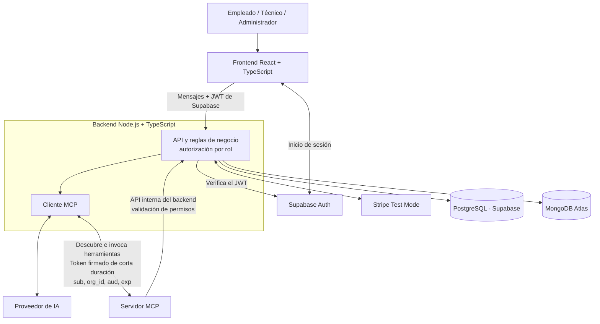
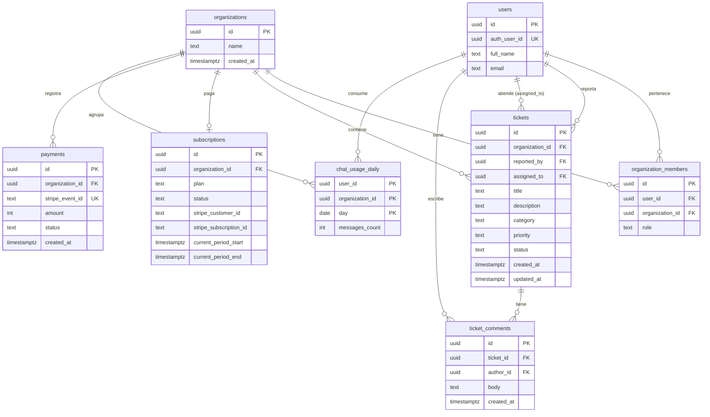

# NexDesk — Propuesta del Proyecto Integrador (Avance 1)

**Materia:** Programación Lógica y Funcional, Unidad 4
**Institución:** Tecnológico Nacional de México, Campus Nuevo León
**Equipo:** 04
**Grupo:** 8AA
**Integrantes:** Arnoldo Aguilar de León
**Fecha:** 24 de noviembre de 2026
**Repositorio:** [ENLACE AL REPOSITORIO]

---

## 1. Idea

NexDesk es una aplicación web de mesa de ayuda (Help Desk) que centraliza las solicitudes de soporte técnico de una organización. Cada solicitud se convierte en un ticket que puede registrarse, consultarse, asignarse y atenderse.

La **interfaz principal** es un **chatbot con IA**: el usuario crea y consulta tickets conversando en lenguaje natural. El chatbot usa **Model Context Protocol (MCP)** para descubrir e invocar herramientas que operan sobre datos reales y autorizados. Existen además vistas web convencionales (listados, detalle, panel de administración) como complemento.

## 2. Problema

Las solicitudes de soporte llegan por correo, mensajes, llamadas y comunicación directa con los técnicos. Esto dificulta centralizarlas, dar seguimiento, identificar pendientes, saber quién atiende cada caso, consultar el historial y medir el rendimiento del área de soporte.

## 3. Usuarios y roles

| Rol | Puede |
|---|---|
| Empleado | Iniciar sesión, crear tickets por chat, consultar sus propios tickets y su estado, comentar, ver su historial de conversaciones. No ve tickets de otros empleados. |
| Técnico | Ver los tickets que le fueron asignados, actualizar su estado y comentar. |
| Administrador | Ver los tickets de su organización, asignarlos a técnicos, gestionar usuarios y roles, ver estadísticas, contratar o cambiar al plan Pro. |

**Regla fundamental:** todos los permisos se validan en el backend. Ni el frontend ni la IA autorizan operaciones.

## 4. Objetivo

**Objetivo general.** Desarrollar y desplegar una plataforma web de mesa de ayuda con un chatbot de IA como interfaz principal, que use MCP para operar de forma segura sobre datos reales de la aplicación.

**Objetivos específicos.**

1. Implementar autenticación y control de roles con autorización en el servidor, con aislamiento de datos por organización.
2. Implementar un servidor MCP y un cliente MCP que descubran e invoquen herramientas sobre las dos bases de datos.
3. Integrar planes Free y Pro con pagos en modo de prueba mediante Stripe.
4. Desplegar la aplicación en producción con documentación y evidencia de pruebas.

## 5. Arquitectura preliminar

| Componente | Tecnología | Función |
|---|---|---|
| Frontend | React + TypeScript | Interfaz web |
| Backend | Node.js + TypeScript | API, lógica de negocio, seguridad y autorización |
| BD principal | PostgreSQL (Supabase) | Usuarios, organizaciones, tickets, suscripciones y pagos |
| BD secundaria | MongoDB Atlas | Conversaciones y mensajes del chatbot |
| Autenticación | Supabase Auth | Identidad y sesiones |
| IA | API de proveedor con tool calling (por definir según límites vigentes) | Interpretación de solicitudes |
| MCP | Servidor TypeScript + cliente dentro del backend | Descubrimiento e invocación de herramientas |
| Pagos | Stripe (modo de pruebas) | Suscripción Pro |
| Despliegue | Vercel (frontend), Render o Railway (backend) | Producción |

El cliente MCP vive dentro del backend. El servidor MCP **no accede directamente a las bases de datos**: llama a la lógica autorizada del backend, que verifica permisos y consulta PostgreSQL o MongoDB.

### Flujo del chatbot

1. El usuario inicia sesión y escribe en el chat.
2. El frontend envía el mensaje al backend, nunca directamente al proveedor de IA.
3. El backend valida la sesión y obtiene usuario, organización activa y rol.
4. El cliente MCP envía el mensaje y las herramientas disponibles al modelo.
5. Si el modelo pide una herramienta, el cliente MCP la invoca en el servidor MCP adjuntando un token interno firmado.
6. El servidor MCP verifica el token, valida los parámetros y llama al backend.
7. El backend comprueba permisos y consulta o modifica la base correspondiente.
8. La conversación se guarda en MongoDB y la respuesta vuelve al usuario.

### Identidad y autorización en MCP

- El backend firma un token interno de corta duración (aprox. 60 s) con `sub` (usuario), `org_id` (organización activa), `aud: "mcp-server"` y `exp`.
- El servidor MCP verifica firma, audiencia y expiración en cada invocación y toma la identidad **solo del token**.
- Los esquemas de las herramientas no incluyen parámetros de identidad; el modelo no ve ni modifica el token.
- El backend vuelve a consultar el rol en `organization_members` en cada operación.
- El contenido de tickets y comentarios se trata como no confiable (mitigación de prompt injection).
- Los endpoints internos que usa el servidor MCP están separados de las rutas públicas del frontend y exigen el token interno firmado; el backend no los acepta sin él.

## 6. Modelo de datos preliminar

### 6.1 PostgreSQL (fuente de verdad)

Datos estructurados, relaciones y operaciones transaccionales.

Notas de diseño:

- `organization_members` es la única fuente de la relación usuario-organización-rol, con `UNIQUE (user_id, organization_id)`. El esquema admite varias organizaciones por usuario; el MVP usa una organización activa.
- `subscriptions` pertenece a la **organización**, porque quien paga es su administrador.
- `payments.stripe_event_id` es único para evitar procesar dos veces el mismo webhook.
- `chat_usage_daily` usa clave primaria compuesta y `INSERT ... ON CONFLICT DO UPDATE` atómico.

### 6.2 MongoDB Atlas

Datos conversacionales de estructura variable.

**`conversations`**

| Campo | Descripción |
|---|---|
| `_id` | Identificador |
| `user_id` | UUID del usuario (PostgreSQL) |
| `organization_id` | UUID de la organización (PostgreSQL) |
| `title` | Título de la conversación |
| `created_at`, `updated_at` | Fechas |

**`messages`** (cada mensaje es un documento independiente, sin arreglos ilimitados)

| Campo | Descripción |
|---|---|
| `_id` | Identificador |
| `conversation_id` | Referencia a `conversations` |
| `user_id`, `organization_id` | UUID de PostgreSQL |
| `ticket_id` | Opcional, UUID del ticket relacionado |
| `role` | `user`, `assistant` o `tool` |
| `content` | Texto del mensaje |
| `created_at` | Fecha |

Índices: `conversation_id`, `user_id`, `created_at`.

### 6.3 Relación entre ambas bases

PostgreSQL es la fuente de verdad. MongoDB referencia sus identificadores. No hay claves foráneas entre motores: el backend valida consistencia y permisos antes de leer o escribir.

## 7. Herramientas MCP propuestas

| Herramienta | Propósito | Base |
|---|---|---|
| `get_my_account` | Perfil, rol, plan y consumo del usuario autenticado | PostgreSQL |
| `create_ticket` | Crear un ticket (usuario y organización salen del token) | PostgreSQL |
| `list_tickets` | Listar tickets visibles según el rol | PostgreSQL |
| `get_conversation_history` | Conversaciones y mensajes recientes del usuario | MongoDB |
| `get_ticket_details` | Detalle de un ticket con verificación de permiso | PostgreSQL |
| `add_ticket_comment` | Agregar un comentario | PostgreSQL |
| `update_ticket_status` | Cambiar el estado (restringido por rol) | PostgreSQL |
| `get_ticket_statistics` | Estadísticas limitadas a la organización y al plan | PostgreSQL |

Cada herramienta se documentará con parámetros, validaciones, permisos, errores, ejemplo de invocación y evidencia de ejecución real.

## 8. Planes y flujo de pago

| Característica | Free | Pro |
|---|---:|---:|
| Precio | $0 MXN | $199 MXN/mes |
| Usuarios | 3 | 10 |
| Tickets mensuales | 30 | 200 |
| Mensajes de chatbot por día y usuario | 20 | 100 |

Los precios y límites son ilustrativos y se validan siempre en el backend.

**Flujo con Stripe Checkout (modo de pruebas):**

1. El administrador consulta los planes y selecciona Pro.
2. El backend crea una sesión de Stripe Checkout.
3. El usuario paga con una tarjeta de prueba de Stripe; no se usan tarjetas reales.
4. Stripe envía un webhook al backend.
5. El backend verifica la firma con el cuerpo original de la petición.
6. Se actualiza `subscriptions` y se registra el evento en `payments`.
7. La aplicación refleja el nuevo plan.

Se documentarán las variables de entorno y los pasos para operar con un proveedor real.
